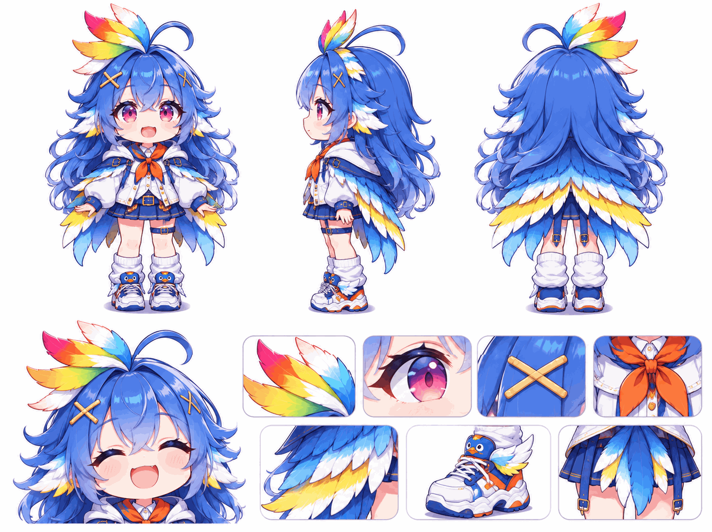

# Cong 娘创作资产库 · Cong-chan

彩羽小鸟的独立拟人创作项目，整理角色参考图、生成提示词、插画和 GIF 表情。参考 [鲸鱼娘资产库](https://github.com/TreapGoGo/deepseek-whale-girl) 的资源组织思路与三视图制作规格，不包含其角色图片、Prompt 或网站代码。

网站图标采用[彩毛小鸟原头像](site/assets/cong-avatar.jpg)，不重新设计。

## 角色素材

- [Q 版三视图与细节](site/assets/cong-chibi-sheet.png) · [Prompt](characters/cong/prompts/chibi.txt)
- [常规比例三视图与细节](site/assets/cong-proportional-sheet.png) · [Prompt](characters/cong/prompts/proportional.txt)（从已有综合设定图提取，独立成熟体尚待制作）
- [综合设定图](site/assets/cong-overview.png) · [白底立绘](site/assets/cong-portrait.png)
- [抱抱小鸟 GIF](site/assets/cong-hug.gif) · [开心抱抱 GIF](site/assets/cong-hug-bounce.gif) · [动画 Prompt](characters/cong/prompts/stickers.txt)
- [视觉设计指南](characters/cong/README.md) · [机器可读素材索引](site/data/assets.json)

## 本地预览

无需 npm 或构建工具。运行 `python -m http.server 8000 --directory site`，打开 `http://localhost:8000`。也可直接打开 `site/index.html`（部分浏览器的剪贴板复制功能需通过 localhost 或 HTTPS 使用）。

## GitHub Pages 部署

先确认图像的发布权限，再新建仓库 `cong-girl`，将本目录内所有文件（包括 `.github`）上传至 `main`。在 Settings → Pages → Build and deployment → Source 选择 **GitHub Actions**，运行 `Deploy site` 工作流。此后推送到 `main` 会自动运行部署工作流。本站会识别 GitHub Pages 地址并生成仓库及 Issues 链接。

## 共建

通过 Issue 投稿作品、推荐资源或反馈错误；通过 Pull Request 维护网站。详见 [CONTRIBUTING.md](CONTRIBUTING.md)。

## 许可

当前是内部创作交付包，视觉资产许可待权利人确认。代码同样尚未由项目所有者选定开源许可证。参见 [RIGHTS.md](RIGHTS.md)。原头像按用户要求随内部交付包收录为站点图标；公开发布前须确认使用许可。不要将参考项目的许可证自动继承为本项目的许可证。
